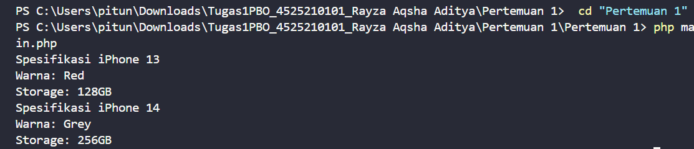
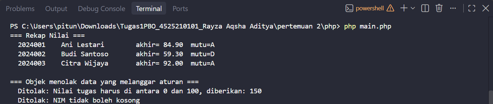
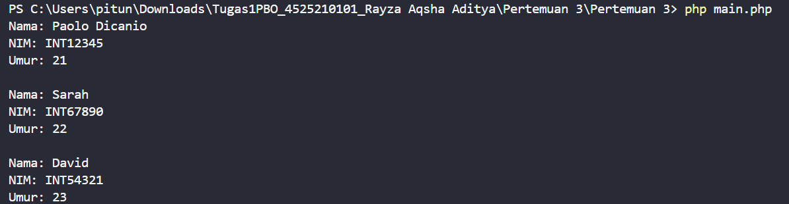
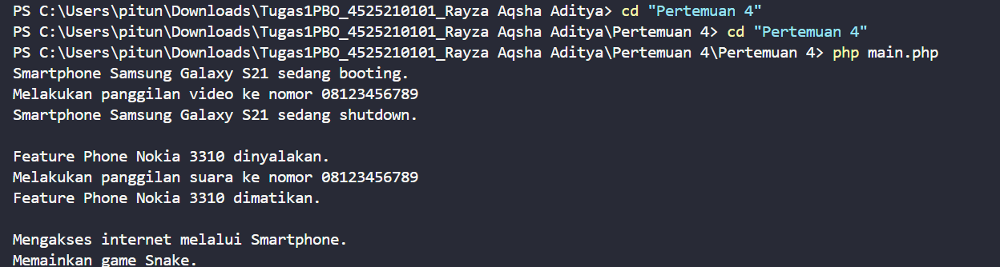
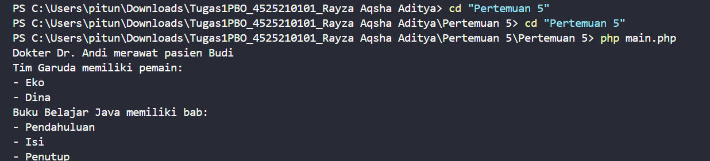
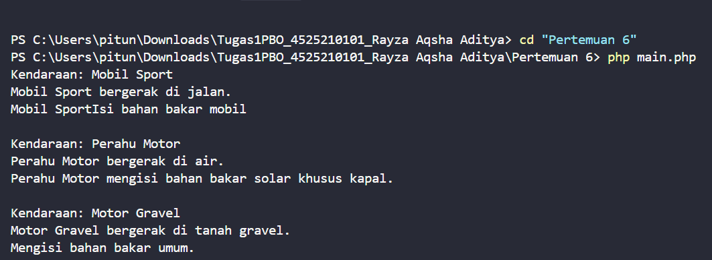

# Teori Pemrograman Berorientasi Objek (PBO)

**:** Rayza Aqsha Aditya-4525210101

---
1. Pastikan PHP sudah terpasang. Periksa melalui terminal:

php --version

2. Buka terminal di folder proyek Tugas1-PBO-A (misalnya melalui Terminal > New Terminal di VS Code), lalu jalankan salah satu perintah berikut. Tanda kutip diperlukan karena beberapa nama folder mengandung spasi:

cd "pertemuan 1"
php Main.php
cd "pertemuan 2"
php Main.php
cd "pertemuan 3"
php Main.php
cd "pertemuan 4"
php Main.php
cd "pertemuan 5"
php Main.php
cd "pertemuan 6"
php Main.php

Jalankan satu perintah setiap kali untuk melihat output contoh tersebut. Perintah-perintah ini juga dapat dijalankan dari folder versiPHP dengan menghapus awalan versiPHP/ dari path berkas.

App.php dan Main.php di folder 03 inheritance adalah dua contoh terpisah: App.php menjalankan contoh pewarisan bangun datar, sedangkan Main.php menjalankan contoh pewarisan kelas mahasiswa.

## Gambar hasil setiap run
## SS PERTEMUAN 1 


## SS PERTEMUAN 2


## SS PERTEMUAN 3


## SS PERTEMUAN 4


## SS PERTEMUAN 5


## SS PERTEMUAN 6


## Struktur Proyek

```
teoriPBO_Rayza Aqsha Aditya_/
├── Pertemuan 1/     # Class & Object
│   ├── Iphone.php
│   └── main.php
├── pertemuan 2/     # Enkapsulasi, Constructor, Getter/Setter
│   ├── Pertemuan 2/
│   │   ├── Mahasiswa.php
│   │   └── Aplikasi.php
│   ├── php/         # Versi PHP: enkapsulasi dengan invariant
│   │   ├── Mahasiswa.php
│   │   └── main.php
│   └── java/        # Versi Java sebagai pembanding
│       ├── Mahasiswa.java
│       └── Main.java
├── Pertemuan 3/     # Inheritance & Method Overriding
│   ├── BangunDatar.php
│   ├── Lingkar.php
│   ├── Persegi.php
│   ├── Segitia.php
│   ├── Mahasiswa.php
│   ├── App.php
│   └── main.php
├── Pertemuan 4/     # Polimorfisme
│   ├── Handphone.php
│   ├── SmartPhone.php
│   ├── FeaturePhone.php
│   └── main.php
├── Pertemuan 5/     # Asosiasi, Agregasi, Komposisi
│   ├── Dokter.php
│   ├── Pasien.php
│   ├── Pemain.php
│   ├── Tim.php
│   ├── Bab.php
│   ├── Buku.php
│   └── main.php
└── Pertemuan 6/     # Abstract Class, Interface, Trait
    ├── Vihicle.php
    ├── Movable.php
    ├── Fuelable.php
    ├── FuelableTrait.php
    ├── Car.php
    ├── Boat.php
    ├── Motor.php
    ├── Building.php
    └── Main.php
```

---

## Ringkasan Materi

| Pertemuan | Topik | Konsep Utama |
|-----------|-------|--------------|
| 1 | Class dan Object | Class, properti `private`, constructor, getter, instansiasi |
| 2 | Enkapsulasi | Constructor dengan nilai default, getter/setter, validasi, `readonly`, invariant |
| 3 | Inheritance | `extends`, override method, pemanggilan method milik parent |
| 4 | Polimorfisme | Override, `parent::__construct`, `protected`, `instanceof` |
| 5 | Relasi antar objek | Asosiasi, agregasi, komposisi |
| 6 | Abstraksi | `abstract class`, `interface`, `trait`, multiple interface |

---


